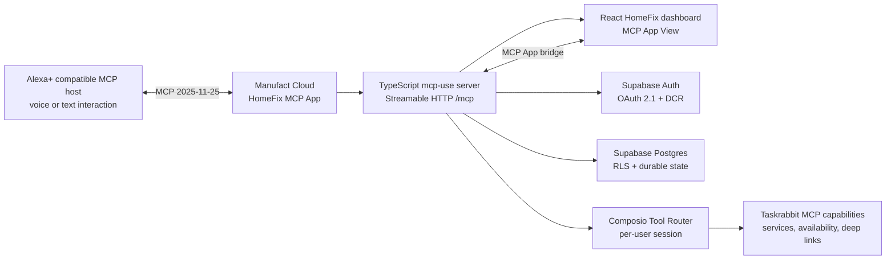
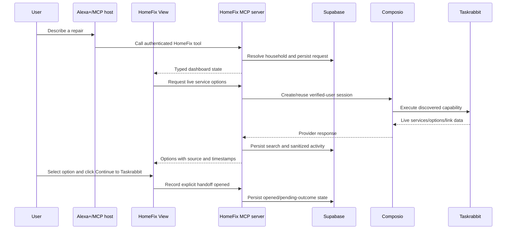

# HomeFix Concierge

> A voice-friendly, screen-supported home-maintenance concierge that turns a repair request into a persistent, live, user-approved Taskrabbit handoff.

HomeFix Concierge is a self-hosted MCP App built for the **Amazon Alexa+ hackathon track**. A connected MCP host can use HomeFix to remember a user's household context, capture repair requests, search live Taskrabbit capabilities through Composio, compare returned options, prepare a validated booking handoff, and preserve the outcome for follow-up.

HomeFix is deliberately designed as one MCP server with one MCP App View. It does not use fabricated provider results, a standalone web simulator, a duplicate chat agent, or an automatic booking claim. The user must explicitly continue to Taskrabbit, and HomeFix only records a booking when the user reports the outcome.

The server also exposes the read-only `get_current_date_time` tool for fresh date/time readings. It accepts an optional IANA timezone and defaults to UTC.

## Live project

- Public MCP endpoint: <https://dark-spark-yobvc.run.mcp-use.com/mcp>
- Local Inspector: <http://localhost:3000/mcp/inspector>
- MCP protocol: `2025-11-25`
- Deployment: Manufact Cloud
- Primary track: Alexa+
- License: MIT

The public endpoint currently passes the deployed protocol/readiness checks, exposes the HomeFix tools and View binding, serves the OAuth consent route, and rejects unauthenticated household access. A fresh authenticated walkthrough is still required before claiming the complete live Taskrabbit journey as verified.

## Why this belongs in Alexa+

Home repair is a natural voice-first task: people often describe a problem while moving around their home and do not want to repeat household details every time they need help. HomeFix combines conversational MCP tool use with a screen-supported View so the host can handle natural-language intake while the user can review locations, prices, status, provenance, and explicit external actions.

For the Alexa+ track, the required technology is used at runtime rather than only being named in this README:

1. `index.ts` imports and instantiates `MCPServer` from `mcp-use`.
2. The same runtime registers the HomeFix MCP tools and serves the `/mcp` Streamable HTTP endpoint.
3. `index.ts` imports and calls `oauthSupabaseProvider` for verified Supabase OAuth identity.
4. `views/homefix-dashboard/view.tsx` imports `mcp-use/react` hooks and calls the deployed HomeFix tools through the MCP App bridge.
5. `src/integrations/composio-taskrabbit.ts` imports `Composio`, creates per-user sessions, discovers the live tool schemas, and calls `session.execute(...)` for Taskrabbit capabilities.
6. `src/integrations/supabase-rest.ts` calls the Supabase REST API for durable household and repair state.

The connected Alexa+/MCP host supplies the conversational or voice experience; HomeFix supplies the authenticated MCP tools, durable state, live provider integration, and interactive View.

## Product flow

1. The user connects to HomeFix through an MCP host.
2. Supabase OAuth verifies the caller and HomeFix resolves the caller's private household.
3. The user explicitly creates one household and saves non-sensitive home context.
4. The user describes one or more repair needs.
5. HomeFix stores the repair request and uses Composio's live Taskrabbit MCP capabilities for supported services and availability/pricing.
6. HomeFix normalizes only returned provider data, shows its source and retrieval time, and compares options against the user's constraints.
7. The user selects an option. HomeFix validates the result freshness and creates a trusted Taskrabbit deep link.
8. The user explicitly clicks **Continue to Taskrabbit**. HomeFix records the handoff as opened, not booked.
9. The user can return later and report booked, cancelled, completed, or unresolved. The same maintenance record is updated.

Provider results expire after 15 minutes. At exactly 15 minutes, HomeFix requires a fresh lookup before preparing a handoff.

## Architecture



### Runtime workflow



## Technology stack

| Technology | Use in HomeFix |
| --- | --- |
| `mcp-use` | MCP server, typed tools, OAuth provider integration, MCP App View binding, Inspector, build, and deployment |
| Model Context Protocol | Host-to-server communication over Streamable HTTP using MCP `2025-11-25` |
| React / React DOM | Interactive HomeFix dashboard View |
| `mcp-use/react` | Tool calls, lifecycle states, model context, and host-mediated external links |
| Supabase Auth | OAuth 2.1, dynamic client registration, consent, and verified identity |
| Supabase Postgres / REST | Household, profile, repair, provider-result, handoff, outcome, and activity persistence |
| `@composio/core` | Per-user Tool Router sessions, schema discovery, and provider execution |
| Taskrabbit through Composio MCP | Live supported-service discovery, availability/pricing lookup, and booking deep-link generation |
| Zod | Narrow input/output schemas and validation for MCP tools |
| `@modelcontextprotocol/client` | Protocol, tool-list, authentication, and deployed endpoint verification |
| TypeScript / Node.js / npm | Application implementation, builds, tests, and scripts |
| Manufact Cloud | Public MCP server and compiled View deployment |

## Repository structure

```text
.
├── index.ts                         # MCP server entrypoint, OAuth, middleware, routes
├── views/
│   └── homefix-dashboard/
│       ├── view.tsx                  # React MCP App View and bridge actions
│       └── view.css                  # View styling
├── src/
│   ├── config/env.ts                 # Environment validation and readiness flags
│   ├── domain/                       # Errors and maintenance state machine
│   ├── integrations/
│   │   ├── composio-taskrabbit.ts    # Live Composio/Taskrabbit adapter
│   │   └── supabase-rest.ts          # Server-side Supabase REST client
│   ├── oauth/consent-page.ts         # Same-deployment OAuth consent page
│   ├── repositories/                 # Household-scoped persistence methods
│   ├── security/                     # Request limits, rate limits, sanitization
│   └── tools/homefix-tools.ts        # HomeFix MCP tool contracts and handlers
├── supabase/migrations/              # Ordered Postgres schema and RLS migrations
├── test/                             # Phase-specific TypeScript test fixtures/checks
├── scripts/                          # Unit, protocol, security, OAuth, and deployment checks
├── docs/                             # PRD, technical specification, coding requirements
├── plan/                             # Phase plans and implementation evidence
├── public/                           # Public View assets and icons
├── .env.example                      # Safe environment variable template
├── LICENSE                            # MIT license
└── package.json                       # Scripts and dependencies
```

## Setup

### Requirements

- Node.js `>=22.22.3`
- npm
- A Supabase project with Auth and Postgres
- A Composio project API key with Session Management write and Session Tool Execution permissions
- A Taskrabbit connection available through Composio
- Supabase CLI for applying migrations

### Install

```bash
npm install
cp .env.example .env
```

On Windows PowerShell:

```powershell
npm install
Copy-Item .env.example .env
```

### Configure environment

Set the server-only values in `.env` or in the deployment environment. Never put service keys, Composio keys, or OAuth tokens in View code.

```text
MCP_URL=https://your-public-host/mcp
SUPABASE_URL=https://your-project.supabase.co
SUPABASE_ANON_KEY=...
SUPABASE_SERVICE_ROLE_KEY=...
COMPOSIO_API_KEY=ak_...
COMPOSIO_API_BASE_URL=https://backend.composio.dev
TASKRABBIT_TOOL_MAP_JSON=
RATE_LIMIT_PER_MINUTE=30
MAX_REQUEST_BYTES=256000
OUTBOUND_TIMEOUT_MS=12000
COMPOSIO_EXECUTION_TIMEOUT_MS=30000
```

`MCP_USE_OAUTH_SUPABASE_PROJECT_ID` and `MCP_USE_OAUTH_SUPABASE_JWT_SECRET` are optional explicit OAuth provider overrides. See [.env.example](.env.example) for the complete variable list.

### Apply database migrations

Apply the migrations in order to the intended Supabase project. They are not applied automatically:

```bash
supabase db push
```

The migrations create household ownership, home profiles, repair requests, service searches, service options, booking handoffs, maintenance events, indexes, constraints, and RLS policies.

### Run locally

```bash
npm run dev
```

The local endpoints are:

- MCP endpoint: <http://localhost:3000/mcp>
- Inspector: <http://localhost:3000/mcp/inspector>
- Health: <http://localhost:3000/health>
- Readiness: <http://localhost:3000/ready>
- OAuth consent: <http://localhost:3000/oauth/consent>

Without external credentials, the server can start for protocol development but remains degraded. Authenticated household workflows require Supabase and Composio configuration.

## Commands and validation

```bash
npm run typecheck        # TypeScript and generated MCP checks
npm run test:unit        # Domain, repository, adapter, security, and expiry tests
npm run build            # Production server and View build
npm run verify:protocol  # Local MCP handshake, schemas, View binding, auth rejection
npm run verify:security  # Scan compiled View assets for secrets
npm run verify:deployed  # Public endpoint protocol/readiness/consent check
npm run verify:phase2-3  # Two-user deployed persistence and isolation check
npm run oauth:token      # Obtain a temporary OAuth token through PKCE
npm run oauth:refresh    # Refresh an existing access token using PHASE1_REFRESH_TOKEN
```

## Alexa+ runtime compliance

The repository demonstrates the required track technology in executable code:

| Requirement | Runtime evidence |
| --- | --- |
| Self-hosted MCP server | `index.ts` imports `MCPServer`, registers tools, and exports the server |
| Streamable HTTP | The deployed `/mcp` endpoint negotiates MCP `2025-11-25` |
| Interactive app surface | `open_homefix_dashboard` binds to `views/homefix-dashboard/` with `outputSchema` and `structuredContent` |
| Connected host interaction | The View uses `useCallTool`, `useToolContext`, `useOpenExternal`, and `ModelContext` |
| Authenticated user state | `oauthSupabaseProvider` verifies identity and repository methods resolve household scope |
| Live external capability | `ComposioTaskrabbitAdapter` creates sessions, discovers schemas, and executes Taskrabbit tools |

This is an Alexa+ MCP implementation rather than a native Alexa device/add-on UI. The hackathon walkthrough is intended to run through the deployed MCP endpoint and a compatible MCP host, with voice input used when supported by that host.


## License

HomeFix Concierge is released under the [MIT License](LICENSE).
